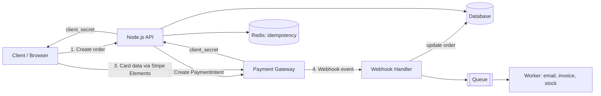
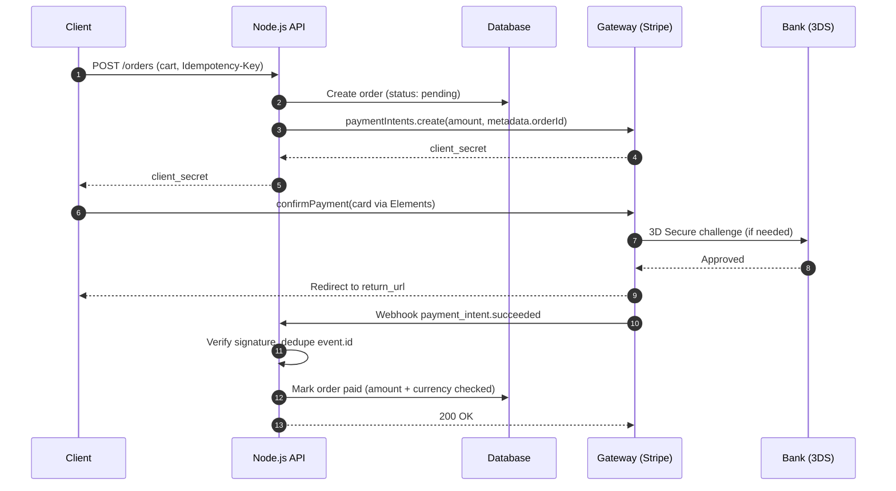
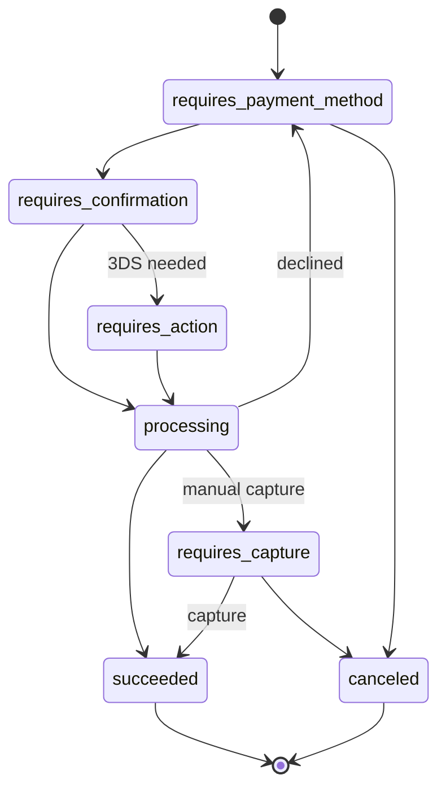
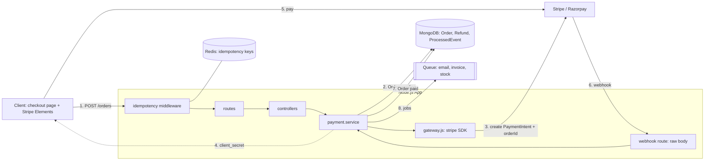

# Architecture - Payment Gateways 💳

Architecture diagrams, request lifecycle and component interactions.

> All diagrams (plus idempotency, verification and refund flows) are rendered in [flowdiagram.html](flowdiagram.html). Open it in a browser.

### 1. Components

| Component | Responsibility |
|-----------|----------------|
| **Client (Web/App)** | Collects card data inside the gateway's secure element. Never sends raw card data to your server. |
| **API Server (Node.js)** | Creates orders and Payment Intents, verifies payments, issues refunds. Holds the **Secret Key**. |
| **Database** | Orders, transactions, refunds, processed webhook event IDs. Source of truth for your business. |
| **Redis** | Idempotency keys and short-lived locks. |
| **Payment Gateway** | Stripe / Razorpay. Talks to card networks and banks. |
| **Webhook Handler** | Receives async events from the gateway, verifies signature, updates DB. |
| **Queue / Worker** | Slow side effects after payment (email, invoice, inventory). Keeps the webhook response fast. |



### 2. Request Lifecycle (Checkout)



### 3. Payment State Machine (Stripe PaymentIntent)



### 4. How the Node App, DB and Payment Gateway Work Together

The gateway only moves money. **Your Node app decides what is being paid for, and your DB remembers it.** The link between them is your `orderId`, which you send to the gateway in `metadata` and get back in every webhook.

#### Folder structure (Express + MongoDB)
```
src/
├── routes/payment.routes.js      # POST /orders, GET /payments/confirm, POST /refunds
├── routes/webhook.routes.js      # POST /webhooks/stripe  (express.raw, mounted BEFORE express.json)
├── controllers/payment.controller.js  # reads req, calls service, sends res
├── services/payment.service.js   # business logic: create order, verify, refund
├── services/gateway.js           # the ONLY file that imports stripe / razorpay
├── models/Order.js               # amount, currency, status, gatewayPaymentId, refundedAmount
├── models/Refund.js
├── models/ProcessedEvent.js      # webhook event IDs (dedupe)
├── middleware/idempotency.js     # Redis SET NX
└── app.js
```

#### Step by step: what each part does and what goes into the DB

| # | Who | Does what | DB after this step |
|---|-----|-----------|--------------------|
| 1 | Client | Clicks **Pay**, sends cart + `Idempotency-Key` | — |
| 2 | Node API | Recalculates price **from DB products** (never trust cart price from client) | — |
| 3 | Node API → DB | Creates order | `Order { status: 'pending', amount: 49900, currency: 'inr' }` |
| 4 | Node API → Gateway | `paymentIntents.create({ amount, metadata: { orderId } })` | — |
| 5 | Node API → DB | Saves gateway ID on the order | `Order { gatewayPaymentId: 'pi_123' }` |
| 6 | Node API → Client | Returns `client_secret` only (secret key never leaves server) | — |
| 7 | Client → Gateway | Card entered in Stripe Elements, 3DS if needed | — |
| 8 | Gateway → Node webhook | `payment_intent.succeeded` with `metadata.orderId` | — |
| 9 | Node webhook | Verify signature → dedupe `event.id` → check amount/currency | `ProcessedEvent { eventId }` |
| 10 | Node webhook → DB | Conditional update `pending → paid` | `Order { status: 'paid', paidAt }` |
| 11 | Node webhook → Queue | Email, invoice, stock update; return `200` fast | — |
| 12 | Cron job | Daily reconciliation: gateway list vs DB | fixes any missed webhook |



```javascript
// services/payment.service.js (glue between DB and gateway)
async function createOrder(userId, cartItems) {
  const amount = await priceFromDb(cartItems);          // server-side price
  const order = await Order.create({ userId, items: cartItems, amount, currency: 'inr', status: 'pending' });
  const pi = await gateway.createPaymentIntent(order);  // metadata.orderId = order._id
  order.gatewayPaymentId = pi.id;
  await order.save();
  return { orderId: order._id, clientSecret: pi.client_secret };
}
```

### 5. Design Rules
- **Webhook is the source of truth**, not the browser redirect. The user can close the tab before the redirect.
- **Store amounts in the smallest unit** (paise / cents) as integers. Never floats.
- **Put your `orderId` in gateway `metadata`** so every webhook maps back to your order.
- **Respond 200 to webhooks fast**; push heavy work to a queue.
- **Every write call to the gateway carries an idempotency key.** See [Idempotency.md](Idempotency.md).
- **Run a reconciliation job** (daily) that compares gateway records with your DB to catch missed webhooks.
